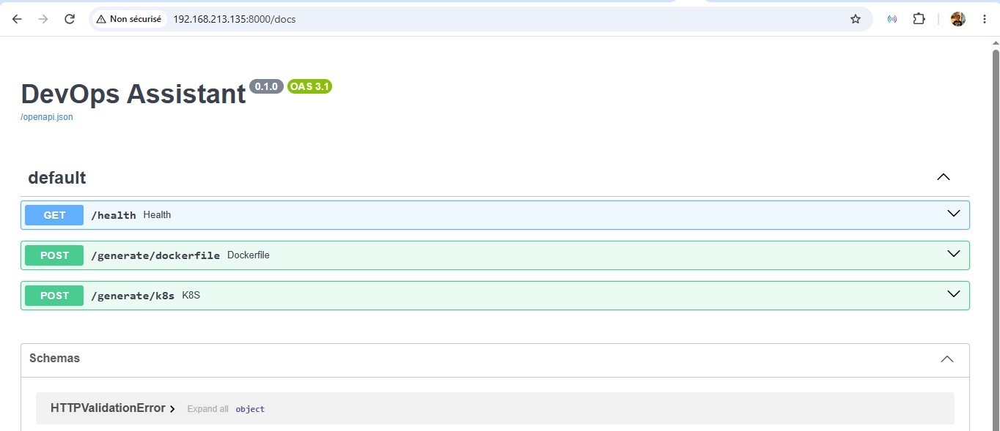
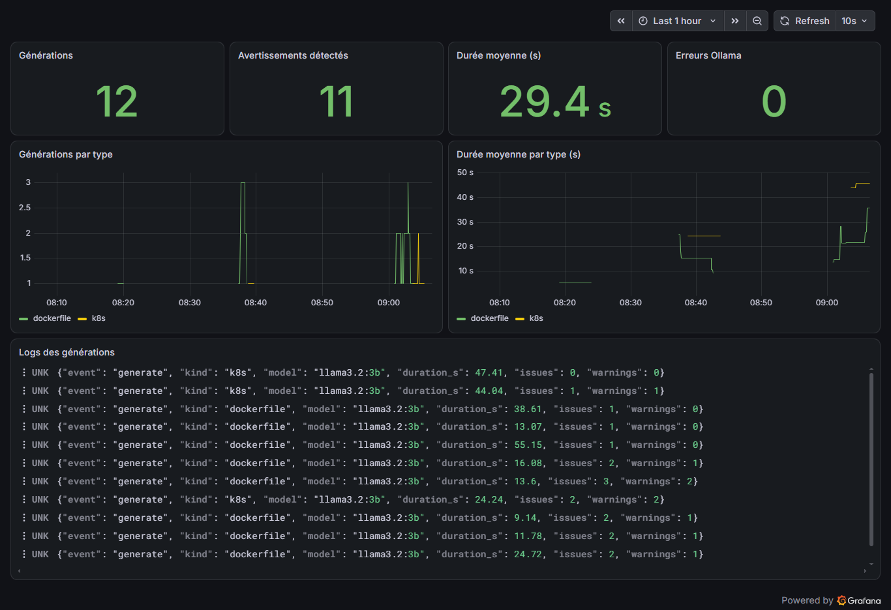

# DevOps Assistant

[](https://github.com/MohamedAliNeji/devops-assistant/actions/workflows/ci.yml)

API qui génère des Dockerfile et des manifests Kubernetes avec un LLM local (Ollama), puis **valide la sortie avec des règles de lint** avant de la renvoyer. Le tout est observable : logs structurés collectés par Alloy, stockés dans Loki, affichés dans un tableau de bord Grafana provisionné par du code.

Projet d'apprentissage : FastAPI, LLM local, Docker Compose, observabilité (Loki / Alloy / Grafana), tests et CI.

## Architecture

```
Client ──► FastAPI (:8000) ──► Ollama (llama3.2:3b, :11434)
               │
               └─ logs JSON (stdout)
                        │
                 Alloy ─┴─► Loki ──► Grafana (:3000)
```

| Composant | Rôle |
|-----------|------|
| FastAPI | Expose `/generate/dockerfile`, `/generate/k8s`, `/health` ; applique les règles de validation |
| Ollama + `llama3.2:3b` | Modèle de langage local, exécuté sur CPU |
| Loki | Stocke les logs |
| Alloy | Collecte les logs des conteneurs Docker et les envoie à Loki |
| Grafana | Tableau de bord (datasource et dashboard provisionnés depuis `grafana/`) |

## Exemple

Requête :

```bash
curl -X POST http://localhost:8000/generate/dockerfile \
  -H 'Content-Type: application/json' \
  -d '{"description": "app Node.js sur le port 3000"}'
```

Dockerfile généré par `llama3.2:3b` (sortie réelle, non retouchée) :

```dockerfile
FROM node:14-slim

USER node

WORKDIR /app

COPY package*.json ./
COPY . .

RUN npm install --force-reinstall

COPY . .

RUN npm run build

EXPOSE 3000

CMD ["npm", "start"]
```

Problèmes détectés par l'API :

| Règle | Gravité | Message |
|-------|---------|---------|
| `eol-image` | warning | Node 14 is end-of-life: use a supported LTS release |
| `npm-force` | warning | npm --force hides dependency conflicts: avoid it |
| `no-healthcheck` | info | No HEALTHCHECK instruction |

La réponse contient `"valid": false` tant qu'un avertissement (warning) est présent.

> Le modèle n'est pas déterministe : une autre exécution peut produire un résultat différent.
> Ce Dockerfile montre pourquoi la sortie d'un LLM doit être validée avant usage.

## Documentation de l'API



## Tableau de bord



Générations, avertissements détectés, durée moyenne, erreurs Ollama, et logs bruts.

## Lancer le projet

Prérequis : Docker, Docker Compose, Ollama avec le modèle `llama3.2:3b`.

```bash
ollama pull llama3.2:3b
docker compose up -d
```

- API : http://localhost:8000/docs
- Grafana : http://localhost:3000/d/devops-assistant

## Tests et CI

```bash
pip install -r requirements.txt pytest
pytest -q
```

GitHub Actions exécute les tests, lint le Dockerfile avec hadolint, puis construit l'image.

## Limites

- Les règles de lint sont simples ; la liste des versions en fin de vie est maintenue à la main.
- Le modèle de 3 milliards de paramètres tourne sur CPU : environ 5 à 55 secondes par requête.
- La sortie du LLM n'est pas déterministe ; certaines erreurs ne sont pas détectées (double `COPY`, `USER` avant l'installation, etc.).

## Pistes d'évolution

- Intégrer hadolint et Trivy dans l'API.
- Exposer des métriques Prometheus.
- Ajouter des règles de lint (double `COPY`, ordre des instructions).
